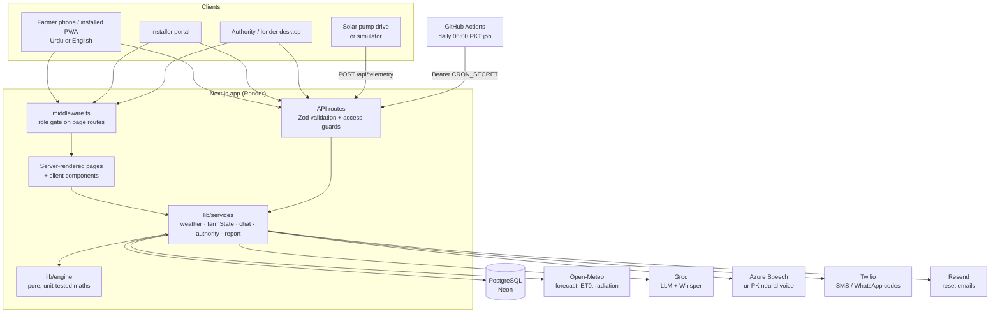
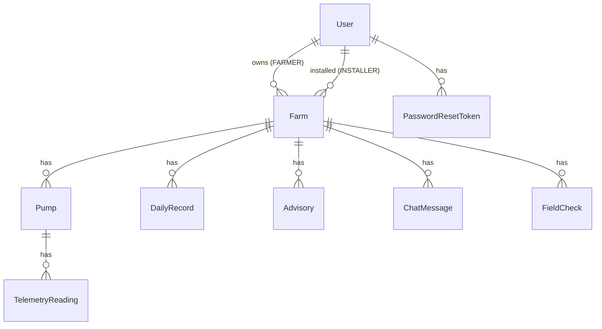
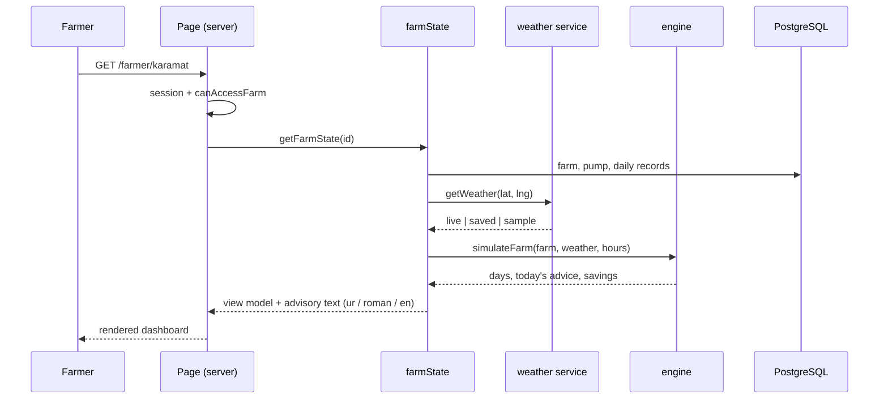
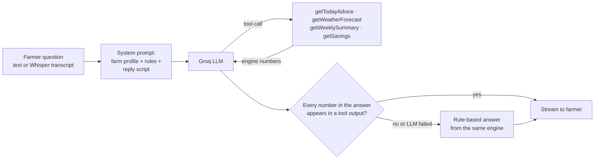
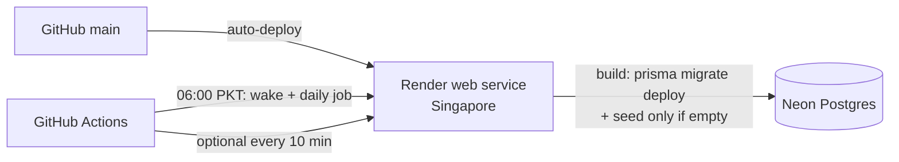

# PaaniPulse: Architecture

How the system is built, how data flows, and where each rule lives. For *why* the product exists, see
[PRODUCT_ESSENTIALS.md](PRODUCT_ESSENTIALS.md). For running and deploying it, see [docs/DEPLOYMENT.md](docs/DEPLOYMENT.md).

## 1. Overview

A single full-stack Next.js app (App Router) backed by PostgreSQL. All numbers are computed by a pure TypeScript
engine; the AI model only phrases messages from numbers the engine returns.



## 2. Technology

| Layer | Choice |
|---|---|
| Framework | Next.js 15 (App Router), React 19, TypeScript (strict) |
| Styling / UI | Tailwind CSS v4, hand-written shadcn-style components, lucide icons, Noto Nastaliq Urdu bundled locally |
| Database | PostgreSQL (Neon) via Prisma 6; pooled `DATABASE_URL` plus `DIRECT_URL` for migrations |
| Validation | Zod on every API input |
| Auth | Signed JWT (HS256, `jose`) in an httpOnly cookie; `bcryptjs` for PIN/password hashes |
| Charts / maps | Recharts; Leaflet + react-leaflet + `leaflet.heat` 0.2 (OpenStreetMap tiles) |
| Weather | Open-Meteo (free tier, optional commercial key) |
| AI | Groq: `openai/gpt-oss-120b` (tool calling), fallback `openai/gpt-oss-20b`; `whisper-large-v3` for speech-to-text |
| Voice | Azure Speech `ur-PK-UzmaNeural` (cached in the database), recorded mp3, browser speech |
| Messaging | Twilio (SMS or WhatsApp), Resend (email); both optional |
| Tests | Vitest (unit tests of engine, services, auth, guardrails) |
| Hosting | Render (web service) + Neon (database) + GitHub Actions (scheduled jobs); Vercel config included as an alternative |

## 3. Repository layout

```
app/                     Pages and API routes (App Router)
  api/                   REST-style JSON endpoints (see section 9)
  farmer/ installer/ authority/ report/ about/ login/ signup/ forgot/ reset/ account/
components/              UI: dashboard cards, chat, map, onboarding wizard, auth forms, install prompt
lib/
  engine/                Pure calculations, no I/O (section 5)
  services/              Everything that touches the outside world or the database
  auth/                  Session tokens, login, reset tokens
  i18n/                  Urdu/English dictionary and language cookie helpers
  api/ http/             Shared response helpers, access guards, redirect helpers
prisma/                  schema.prisma, migrations, seed.ts (demo data)
scripts/                 Telemetry simulator, seed-if-empty (used by builds)
tests/                   Vitest suites
public/                  Icons, service worker, offline page, optional recorded voice note
.github/workflows/       Daily advisory job and optional keep-warm ping
render.yaml vercel.json  Hosting configuration
```

**Layering rule:** `lib/engine` imports nothing from the app. `lib/services` may use the engine, Prisma and external
APIs. Pages and API routes call services, never the other way round.

## 4. Data model



| Model | Purpose |
|---|---|
| `User` | `role` = FARMER / INSTALLER / AUTHORITY; farmers log in by `phone` + PIN, others by `email` + password (bcrypt hashes); `smsAdvice` opt-in for text messages |
| `Farm` | Location, district, crop, sowing date, area, irrigation method, language, `dataConsent`, `isSynthetic`, owner and installer |
| `Pump` | Rated kW, panel kWp, static water level (ft), drawdown, efficiency, `calibrated`, `hasTelemetry`, `lastOverrunAlert` (date of the last over-run SMS) |
| `TelemetryReading` | Drive readings: timestamp, power kW, frequency Hz |
| `DailyRecord` | One row per farm per day: reported/estimated pump hours plus engine outputs (ET₀, ETc, rain, need, pumped, excess, wasted kWh, PV and spare kWh) |
| `Advisory` | Daily advice in Urdu, Roman Urdu and English |
| `ChatMessage` | Chat history per farm |
| `FieldCheck` | A real drum measurement vs the app's prediction |
| `PasswordResetToken` | Hashed email tokens and HMAC-hashed SMS codes, with expiry and attempt counter |
| `WeatherCache` | Last good Open-Meteo response per ~11 km cell (survives restarts) |
| `AudioCache` | Neural TTS audio keyed by hash of voice and text |

## 5. The engine (`lib/engine`)

Pure functions, all unit-tested. Units are SI inside; acres and feet are converted at the edges.

| Module | Responsibility |
|---|---|
| `config.ts` | Crop table (FAO-56 Kc, stage lengths, root depth, depletion fraction p), irrigation efficiencies, defaults, critical growth stages |
| `cropWater.ts` | Kc by day since sowing, ETc, effective rain, net and gross need |
| `waterBalance.ts` | Root depth, TAW, RAW, one-day soil-water balance step |
| `solar.ts` | Day length; hourly irradiance from a daily total |
| `pump.ts` | Head, flow from power, PV power, Mode A (telemetry) and Mode B (sunlight) integration, bucket-test calibration, flow range, pump output in farmer units |
| `advice.ts` | Turns balance state into *irrigate / keep off / skip for rain*, hours, days to next irrigation, critical-stage rule |
| `savings.ts` | Wasted kWh, spare-solar value, nitrogen/urea estimate |
| `simulate.ts` | Day-by-day farm simulation that ties the above together |

### Key formulas

```
ETc = Kc × ET0                                   Dr(t) = Dr(t-1) + ETc − 0.8·rain − pumped·efficiency/area
TAW = 140 mm/m × root depth                      Irrigate when Dr ≥ RAW = p × TAW
H   = (static level + 3 m drawdown) × 1.1        Q = η × P / (ρ g H)           (η default 0.40)
PV  = kWp × GHI/1000 × 0.75, capped at pump kW, zero below 20% of rated
Bucket test: η = ρ g H Q_measured / P            Wasted kWh = excess m³ × ρ g H / η / 3.6e6
```

### Two measurement modes

- **Mode B (default):** hourly sunlight from Open-Meteo gives PV power, then flow. Running hours are assumed to be the
  sunniest hours (farmers run around midday). Hours come from the farmer's daily report or from drive telemetry; a farm with no reports counts as 0 hours.
- **Mode A (upgrade):** the solar drive's power readings are integrated (trapezoid rule, gaps over 15 minutes counted
  as off). Today's total is shown live and yesterday's hours feed the daily job.

### Known simplifications

- The soil-water balance restarts at field capacity at the start of the 31-day window each time it is computed.
- One pump per farm is used (`pumps[0]`); the whole farm is treated as one field with loam soil.
- Rice uses a daily-need model with 4 mm/day percolation instead of the balance.
- Over-pumping counts only the drainage caused by pumped water, not by rain.

## 6. Request flows

### Farmer dashboard (`/farmer/[id]`)



**Weather fallback chain** (the badge on screen always says which one was used):

1. In-memory cache, 30 minutes by default (`WEATHER_CACHE_MINUTES`), shared by farms within about 11 km
2. Live Open-Meteo call (past 31 days + 7-day forecast, hourly sunlight, temperature, humidity, wind and rain chance, current conditions)
3. Last good response saved in `WeatherCache`
4. Built-in offline sample (only when `DEMO_MODE` is not `false`)

If `OPEN_METEO_API_KEY` is set, the commercial host is used; a rejected key falls back to the free host. `OPEN_METEO_BASE_URL` points the app at a self-hosted Open-Meteo.

**Live updates on screen:** the dashboard's weather card (`WeatherLive`) polls `GET /api/farms/[id]/weather-now` every 5 minutes while the page is visible and when the tab comes back to the front. The endpoint answers from the server cache, so polling does not multiply Open-Meteo calls; current conditions are therefore at most about 30 minutes old (Open-Meteo itself refreshes them every ~15 minutes).

### Chat (`POST /api/chat`)



- The model is **not fine-tuned**. Personalisation comes from the farm profile in the prompt, the tools' farm-specific
  results, and the last 4 messages.
- The reply script (Urdu, Roman Urdu, English) is chosen server-side from the farmer's message.
- On a rate limit the call is retried once on a smaller model, then falls back to rule-based answers.

### Daily job (06:00 PKT)

GitHub Actions (or Vercel Cron) calls `GET /api/cron/daily-advisory` with `Authorization: Bearer $CRON_SECRET`. For each
real farm it turns yesterday's telemetry into run-hours, recomputes the last 14 `DailyRecord`s (this feeds the authority
map), stores today's `Advisory` and pre-generates the Urdu voice note when Azure is configured.

### Authority aggregation

`lib/services/authority.ts` aggregates `DailyRecord`s of consenting farms by district, crop and window. It exposes only a
district code plus a hashed reference, coordinates blurred to about 1 km, and no names or phone numbers. The heatmap
weights points by m³ per acre per day.

### Offline and alerts

Village connections are unreliable, so the farmer side degrades in layers:

| Situation | What happens | Where |
|---|---|---|
| No internet | `public/sw.js` serves `public/offline.html`, which shows the **last advice saved on the phone** (Urdu / Roman / English, voice via the phone's speech engine) | `lib/offline.ts`, `OfflineSnapshot`, `offline.html` |
| Report pump hours offline | Saved in `localStorage` and sent when the connection returns (`online` event, every minute while the app is open) | `ReportHours`, `flushQueue` |
| Farmer switches the pump on | **Pump timer**: rings a repeating beep (Web Audio, no sound files), vibrates, shows a full-screen "switch the pump off now", and records the run time. Runs entirely on the phone | `PumpTimer`, `lib/alarm.ts` |
| Drive shows the pump over-running | Live meter shows a red warning and beeps (if the farmer turned the alarm sound on) | `LiveMeter` |
| No internet at all, no app | Opt-in **SMS / WhatsApp**: the daily advice at 06:00 and a "pump ran too long" text (drive-connected farms, once a day) | `dailyAdvisory.ts`, `overrunAlert.ts`, `smsText.ts` |

Stored on the phone: the latest advice, queued reports and the running timer. All are wiped on sign-out (phones are
shared). The alarm cannot run while the phone is locked or the browser is closed; SMS is the fallback for that.

## 7. Authentication and access control

| Mechanism | Detail |
|---|---|
| Sessions | HS256 JWT, 30 days, `httpOnly`, `Secure` in production, `SameSite=Lax`; secret is `AUTH_SECRET` |
| Page gate | `middleware.ts` protects `/farmer`, `/installer`, `/authority`, `/report`; unsigned users go to `/login`, wrong roles go home |
| Farm access | `canAccessFarm`: a farmer sees farms they own; an installer sees farms they installed; **authorities never see farm pages** |
| Authority data | Anonymised; only farms with `dataConsent`; reports are anonymised for authorities |
| Brute force | 8 failed logins per identifier per 15 minutes (in memory); SMS codes lock after 5 wrong guesses, max 3 per hour |
| Account recovery | Farmers: SMS/WhatsApp code or installer reset. Installers and officials: emailed one-time link (30 min, hash stored) |
| Demo accounts | Seeded; one-tap login while `DEMO_MODE` is not `false`; their PIN/password can never be changed |

## 8. Access matrix (API)

| Route group | Who may call it |
|---|---|
| `/api/auth/*` | Anyone (credential-based); reset routes return identical answers whether or not an account exists |
| `/api/farms` (POST) | Farmer (own farm) or installer (registers farmer and farm); not authorities |
| `/api/farms/[id]/*` (incl. `weather-now`), `/api/chat` | Owner farmer or the installing installer (`guardFarm`) |
| `/api/tts`, `/api/stt`, `/api/account/password` | Any signed-in user |
| `/api/account/sms` | Farmers only (demo account refused) |
| `/api/installer/reset-pin` | Installer, only for farmers of farms they installed |
| `/api/authority/*` | Authority only |
| `/api/telemetry` | Anyone, **unless `TELEMETRY_INGEST_KEY` is set** (then the `x-ingest-key` header is required); unknown pump ids are rejected |
| `/api/cron/daily-advisory` | Bearer `CRON_SECRET` |
| `/api/weather`, `/api/health` | Public (health only reports yes/no flags and counts, never secret values) |

## 9. API reference

| Method and path | Purpose |
|---|---|
| `POST /api/auth/signup`, `login`, `logout`, `demo` | Create account, sign in, sign out, one-tap demo sign-in |
| `POST /api/auth/forgot`, `reset` | Email reset link for installers/officials |
| `POST /api/auth/forgot-phone`, `reset-phone` | SMS/WhatsApp 6-digit code for farmers |
| `POST /api/account/password` | Change own PIN/password |
| `POST /api/installer/reset-pin` | Installer sets a farmer's PIN |
| `POST /api/farms` | Create a farm (farmer or installer) |
| `GET /api/farms/[id]` | Farm and pump (no phone number) |
| `GET /api/farms/[id]/advice?date=` | Run the engine; store `DailyRecord` and `Advisory`; return the full view model |
| `POST /api/farms/[id]/calibrate` | Bucket test, or `{reset:true}` |
| `POST/GET /api/farms/[id]/field-check` | Record and list meter field checks |
| `POST /api/farms/[id]/hours` | Pump hours for a day (0 = today … 7); `add:true` adds to the stored hours (used by the pump timer) |
| `POST /api/account/sms` | Farmer turns daily advice / over-run texts on or off |
| `GET /api/farms/[id]/live` | Today's live meter from telemetry |
| `POST /api/telemetry` | JSON array, `{readings:[]}`, CSV body or multipart CSV upload |
| `POST /api/chat`, `DELETE /api/chat?farmId=` | Streamed AI chat; clear history |
| `POST /api/tts`, `POST /api/stt` | Text to speech (mp3), speech to text (Whisper) |
| `GET /api/weather?lat=&lng=` | Weather for a point (cached) |
| `GET /api/farms/[id]/weather-now` | Current conditions and next 24 hours for a farm (polled by the dashboard) |
| `GET /api/authority/summary\|heatmap\|export.csv` | Regional aggregation, heat points, CSV |
| `GET /api/cron/daily-advisory` | Daily job (Bearer `CRON_SECRET`) |
| `GET /api/health[?full=1]` | Liveness; with `full=1` also configuration, database and weather checks |

## 10. Internationalisation

All UI text lives in `lib/i18n/dict.ts` with an English and an Urdu entry for every key (enforced by the type). The
language is a cookie; farmer pages default to the farm's language. Urdu pages are right-to-left with a bundled Nastaliq
font; numbers and units are isolated so they do not flip. Advisory text exists in Urdu script, Roman Urdu and English.

## 11. Deployment



- Build command: `npm ci --include=dev && npm run render-build`; start: `npm start`; health check: `/api/health`.
- Migrations run on every deploy; the demo seed runs **only when the database has no farms**, so real data is never wiped.
- The free Render plan sleeps after about 15 minutes idle; the optional keep-warm workflow and a manual visit before
  presenting avoid the cold start.
- Redirects behind the proxy use relative `Location` headers or `x-forwarded-*` headers, so users are never sent to
  `localhost`.

## 12. Testing and quality

- `npm test`: Vitest suites for the engine (crop water, balance, pump physics, calibration, advice, critical stage,
  pump output), services (weather parsing, advisory text, current weather), chat guardrails, authority helpers,
  telemetry CSV and auth tokens.
- `npm run build` runs the TypeScript type-check; `npm run lint` runs ESLint.
- Manual end-to-end checks were done for roles and ownership, signup and onboarding, SMS and email reset flows
  (against a mock provider), telemetry and the live meter, the PWA, and a clean install from the repository.

## 13. Known limitations and technical debt

- **Not yet validated in the field** (see PRODUCT_ESSENTIALS.md): the meter has not been compared with a real flow
  measurement, and no real farm has used it.
- The login rate limiter and the weather memory cache are **per server instance**; a multi-instance deployment needs a
  shared store.
- `/api/telemetry` is open unless `TELEMETRY_INGEST_KEY` is set. Set it before connecting real drives.
- `/api/weather` and `/api/health?full=1` are public and not rate-limited.
- The pump alarm needs the app open and the phone awake; it cannot switch the motor off (no hardware). Over-run SMS needs a connected drive, runs per server instance and is checked at most every 5 minutes per pump.
- No email verification and no separate CSRF token (cookies are `SameSite=Lax`).
- The authority view and the district ranking rest on simulated data.
- Only Twilio is implemented for SMS; a local Pakistani provider would be a second implementation of `lib/services/sms.ts`.

## 14. Extension points

| To add | Where |
|---|---|
| A crop or critical stage | `lib/engine/config.ts` (`CROPS`, `CRITICAL_STAGES`) plus tests |
| A weather provider | `lib/services/weather.ts` (return the same `WeatherResult`) |
| An SMS provider | `lib/services/sms.ts` |
| A chat tool | `lib/services/chatTools.ts` (`TOOL_DEFS`, `runTool`); keep numbers coming from the engine |
| A language | `lib/i18n/dict.ts` (add a dictionary; the type forces every key) |
| A real drive integration | A client that POSTs to `/api/telemetry` (the data model already supports it) |
