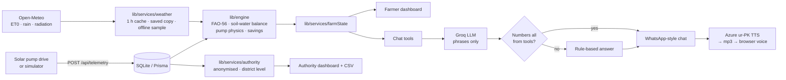

# PaaniPulse

**Solar made pumping free. PaaniPulse makes it smart.**

A virtual water and energy meter plus an Urdu irrigation advisor for solar tube wells, with no extra hardware.
Built for the LUMS CfE × OGDCL CleanTech Hackathon 2026 (theme: Renewable & Alternative Energy) by
Qursam Bibi and Muzammil Hussain.

## Setup

```bash
cp .env.example .env       # fill in DATABASE_URL / DIRECT_URL (Neon or local Postgres) and AUTH_SECRET
npm install
npx prisma migrate dev     # creates the tables and runs the seed (Karamat + 150 simulated wells)
npm run dev                # http://localhost:3000
```

For local Postgres you can also use a free Neon *branch* of your production database.

| Command | What it does |
|---|---|
| `npm test` | Unit tests (engine, services, guardrails) |
| `npm run build` | Production build (type-checks everything) |
| `npm run seed` / `npm run demo:reset` | Reset all demo data (chat, calibration, telemetry) |
| `npm run simulate` | Stream live pump-drive readings for the demo farm (`-- --url http://localhost:3000`) |
| `npm run simulate:reset` | Remove simulated readings (farm goes back to "estimated from sunlight") |

### Environment variables

| Variable | Needed? | What it does / what happens without it |
|---|---|---|
| `DATABASE_URL` | yes | Postgres connection (Neon: the **pooled** URL, host contains `-pooler`) |
| `DIRECT_URL` | yes | Direct Postgres URL for migrations (Neon: the unpooled URL; locally the same as `DATABASE_URL`) |
| `AUTH_SECRET` | yes | Signs login sessions. Any long random string, e.g. `openssl rand -base64 32` |
| `AUTHORITY_INVITE_CODE` | for authority sign-up | Code an Irrigation Dept / lender must enter to create an account |
| `GROQ_API_KEY` | for AI chat + voice input | Without it: rule-based chat answers (same numbers), typing only |
| `GROQ_MODEL` | no | Defaults to `openai/gpt-oss-120b` (falls back to `openai/gpt-oss-20b` on rate limit) |
| `AZURE_SPEECH_KEY`, `AZURE_SPEECH_REGION` | no | Urdu neural voice (`centralindia`). Without: recorded mp3 or the phone's own voice |
| `CRON_SECRET` | for the daily 06:00 advisory | Vercel sends it automatically to the cron job |
| `TELEMETRY_INGEST_KEY` | no | If set, pump drives / the simulator must send it as `x-ingest-key` |
| `DEMO_MODE` | no (default `true`) | Offline sample weather fallback + one-tap demo accounts. Set `false` for a real launch |

### Demo accounts (seeded)

| Role | Sign in with | Sees |
|---|---|---|
| Farmer (Karamat) | phone `03000000000`, PIN `1234` | `/farmer/karamat`, chat, report |
| Installer (Shahid Solar) | `installer@paanipulse.demo` / `demo1234` | `/installer` (26 farms) |
| Irrigation Dept | `authority@paanipulse.demo` / `demo1234` | `/authority`, anonymised reports |

Or tap the "Try the demo" buttons on the home page.

## Deploy on Render + Neon (recommended for this team)

1. **Neon**: in your project click **Connect**. Copy the connection string **with "Connection pooling" ON**
   (`DATABASE_URL`, host contains `-pooler`) and again **with pooling OFF** (`DIRECT_URL`).
   If you only have one string, use it for both. Never commit it or paste it in chats.
2. **Render** (https://render.com): **New → Blueprint** → connect GitHub → pick `paanipulse`. Render reads `render.yaml`
   (Singapore region, build `npm ci --include=dev && npm run render-build`, start `npm start`, health check `/api/health`).
3. Render asks for the secret values: `DATABASE_URL`, `DIRECT_URL`, `GROQ_API_KEY`, `AZURE_SPEECH_KEY`,
   `AUTHORITY_INVITE_CODE`. `AUTH_SECRET` and `CRON_SECRET` are generated automatically.
4. **Apply**. The first build creates the tables and seeds the demo data (only when the database is empty).
   Later deploys never wipe real accounts. After changing a variable: *Manual Deploy → Deploy latest commit*.
5. **Daily 06:00 advisory (free)**: GitHub repo → *Settings → Secrets and variables → Actions* → add secrets
   `APP_URL` (your `https://….onrender.com`) and `CRON_SECRET` (copy it from Render → Environment).
   `.github/workflows/daily-advisory.yml` then runs every morning; test it with *Actions → Daily advisory → Run workflow*.
6. **Free plan sleeps after ~15 min idle** (first visit then takes 30–60 s). On demo day, add the repository *variable*
   `KEEP_WARM = true` to enable `.github/workflows/keep-warm.yml`, and open the site yourself a minute before presenting.
   Remove it afterwards, or use Render's paid "Starter" plan to stay awake.

## Deploy on Vercel (alternative)

1. **Neon** (https://neon.tech) → create a project (region: closest available to Pakistan, e.g. Singapore or Frankfurt).
   From *Connection details* copy two strings: the **pooled** one (`DATABASE_URL`) and the **direct** one (`DIRECT_URL`).
2. **Vercel** (https://vercel.com) → *Add New → Project* → import the GitHub repo `paanipulse`.
3. Before the first deploy, open *Environment Variables* and add the variables from the table above
   (at least `DATABASE_URL`, `DIRECT_URL`, `AUTH_SECRET`, `GROQ_API_KEY`, `CRON_SECRET`, `DEMO_MODE=true`).
4. Click **Deploy**. The build (`vercel-build`) applies the database migrations, seeds the demo data **only if the
   database is empty**, and builds the app. Later deploys never wipe your real accounts.
5. After changing any environment variable, redeploy (*Deployments → ⋯ → Redeploy*).
6. The daily advisory job is configured in `vercel.json` (01:00 UTC = 06:00 PKT).

Run the live-meter simulator against the deployed site from your laptop:

```bash
npm run simulate -- --url https://YOUR-APP.onrender.com   # or your vercel.app URL
```

**Recorded voice note (recommended for the demo):** record the daily advisory in your own voice and save it as
`public/audio/advisory-karamat.mp3`. It plays when Azure TTS is not configured, and works with no internet.

## Pages

| URL | For | What it shows |
|---|---|---|
| `/` | everyone | Problem, how it works (Urdu / English) |
| `/login`, `/signup` | everyone | Farmer (phone + PIN), installer / authority (email + password) |
| `/farmer/onboard` | farmer | 4-step farm set-up (map, crop, pump, consent) |
| `/installer` | installer | Farms installed, status, register a farmer |
| `/report/<farmId>` | farmer, installer, lender | Printable 30-day well report (anonymised for lenders) |
| `/farmer/karamat` | farmer (mobile) | Yesterday vs need, today's advice + voice note, live meter, weekly waste, chart, spare sunshine, bucket test, weather |
| `/farmer/karamat/chat` | farmer (mobile) | WhatsApp-style assistant (Urdu script, Roman Urdu, English) |
| `/authority` | Irrigation Dept / lenders (desktop) | Heatmap of 151 wells, filters, KPIs incl. MWh wasted, district table, CSV export |
| `/about` | judges | Formulas, defaults, data sources, limitations, privacy |

## Architecture



- `lib/engine/`: pure, unit-tested calculations (no I/O)
- `lib/services/`: weather, farm state, advisory text, chat tools, LLM, TTS, authority aggregation
- `app/`: pages and API routes (all inputs validated with Zod)
- `components/`: UI (dashboard, chat, map, language toggle, voice player)

## Formulas (see `/about` for the full list)

```
ETc = Kc × ET0                              (FAO-56 crop coefficient by growth stage)
Dr(t) = Dr(t-1) + ETc − 0.8 × rain − pumped × efficiency / area   (root-zone depletion)
Irrigate when Dr ≥ RAW = p × 140 mm/m × root depth; else "keep the pump off"
H = (static water level + 3 m) × 1.1        Q = η × P / (ρ g H)
PV power = kWp × GHI / 1000 × 0.75          Bucket test: η = ρ g H Q_measured / P
Wasted kWh = excess m³ × ρ g H / η / 3.6e6  Value = kWh × Rs 20
```

## 3-minute demo script

Before going on stage: `npm run demo:reset`, open two tabs (`/farmer/karamat` in Urdu, `/authority` in English),
and keep a terminal ready with `npm run simulate`.

1. **Landing (0:00–0:20):** "650,000 solar tube wells. 77% of solar farms pump more than diesel farms. Zero meters."
2. **Karamat's farm:** "Kal 6 ghantay chala, zaroorat 0" → **"Aaj pump band rakhein"** → play the Urdu voice note.
3. **This week:** pumped 84% more than needed: 444,000 L lost below the roots, ~5 kg urea, 101 kWh of solar.
4. **Start the simulator:** the live water meter starts counting within seconds, with no hardware.
5. **Bucket test:** 200 L in 21 s → the flow range narrows (the meter is calibrated to this pump). A slower fill
   (e.g. 24 s) lowers the efficiency and every litre/kWh figure updates, which is correct but changes the numbers mid-demo.
6. **Chat:** tap "kal barish hogi?" → rain expected, keep the pump off. Mention the number guardrail.
7. **Spare sunshine:** about Rs 1,000 a day from e-rickshaw battery charging on a "pump off" day.
8. **Authority dashboard:** heatmap of 151 wells, 59 losing >30%, 5.6 MWh wasted → filter Narowal → Export CSV.
9. **Close:** "Solar made pumping free. PaaniPulse makes it smart."

Backup video: record this flow once on good Wi-Fi in case the venue network fails.

## Screenshots

_Add screenshots here: landing, farm dashboard (Urdu), chat, authority dashboard._

## Data honesty

- The 150 regional wells are **simulated demo data** (clearly labelled in the UI).
- The demo farm's pumping pattern is based on a real farmer interview (runs the pump 7–8 h on sunny days,
  "about double" the water since going solar).
- Fertiliser and income figures are estimates and labelled as such.
