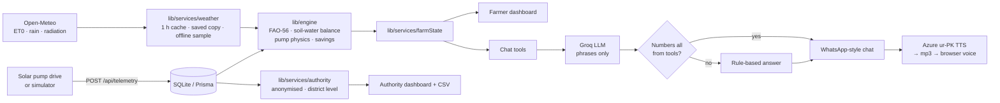

# PaaniPulse

**Solar made pumping free. PaaniPulse makes it smart.**

A virtual water and energy meter plus an Urdu irrigation advisor for solar tube wells, with no extra hardware.
Built for the LUMS CfE × OGDCL CleanTech Hackathon 2026 (theme: Renewable & Alternative Energy) by
Qursam Bibi and Muzammil Hussain.

## Setup

```bash
cp .env.example .env
npm install
npx prisma migrate dev     # creates the SQLite DB and runs the seed (Karamat + 150 simulated wells)
npm run dev                # http://localhost:3000
```

| Command | What it does |
|---|---|
| `npm test` | Unit tests (engine, services, guardrails) |
| `npm run build` | Production build (type-checks everything) |
| `npm run seed` / `npm run demo:reset` | Reset all demo data (chat, calibration, telemetry) |
| `npm run simulate` | Stream live pump-drive readings for the demo farm (`-- --url http://localhost:3000`) |
| `npm run simulate:reset` | Remove simulated readings (farm goes back to "estimated from sunlight") |

### Environment variables

| Variable | Needed? | What happens without it |
|---|---|---|
| `DATABASE_URL` | yes | — |
| `GROQ_API_KEY` | for AI chat | Chat uses rule-based answers (same numbers) |
| `GROQ_MODEL` | no | Defaults to `openai/gpt-oss-120b` (falls back to `openai/gpt-oss-20b` on rate limit) |
| `AZURE_SPEECH_KEY`, `AZURE_SPEECH_REGION` | no | Voice note plays `public/audio/advisory-<farmId>.mp3` if present, else the phone's own Urdu voice |
| `DEMO_MODE` | no (default `true`) | With `true`, offline sample weather is used if Open-Meteo is unreachable |

**Recorded voice note (recommended for the demo):** record the daily advisory in your own voice and save it as
`public/audio/advisory-karamat.mp3`. It plays when Azure TTS is not configured, and works with no internet.

## Pages

| URL | For | What it shows |
|---|---|---|
| `/` | everyone | Problem, how it works (Urdu / English) |
| `/farmer/karamat` | farmer (mobile) | Yesterday vs need, today's advice + voice note, live meter, weekly waste, chart, spare sunshine, bucket test, weather |
| `/farmer/karamat/chat` | farmer (mobile) | WhatsApp-style assistant (Urdu script, Roman Urdu, English) |
| `/authority` | Irrigation Dept / lenders (desktop) | Heatmap of 151 wells, filters, KPIs incl. MWh wasted, district table, CSV export |
| `/about` | judges | Formulas, defaults, data sources, limitations, privacy |

## Architecture



- `lib/engine/`: pure, unit-tested calculations (no I/O)
- `lib/services/`: weather, farm state, advisory text, chat tools, LLM, TTS, authority aggregation
- `app/`: pages and API routes (all inputs validated with Zod)
- `components/`: UI (dashboard, chat, map, language toggle, voice player)

## Formulas (see `/about` for the full list)

```
ETc = Kc × ET0                              (FAO-56 crop coefficient by growth stage)
Dr(t) = Dr(t-1) + ETc − 0.8 × rain − pumped × efficiency / area   (root-zone depletion)
Irrigate when Dr ≥ RAW = p × 140 mm/m × root depth; else "keep the pump off"
H = (static water level + 3 m) × 1.1        Q = η × P / (ρ g H)
PV power = kWp × GHI / 1000 × 0.75          Bucket test: η = ρ g H Q_measured / P
Wasted kWh = excess m³ × ρ g H / η / 3.6e6  Value = kWh × Rs 20
```

## 3-minute demo script

Before going on stage: `npm run demo:reset`, open two tabs (`/farmer/karamat` in Urdu, `/authority` in English),
and keep a terminal ready with `npm run simulate`.

1. **Landing (0:00–0:20):** "650,000 solar tube wells. 77% of solar farms pump more than diesel farms. Zero meters."
2. **Karamat's farm:** "Kal 6 ghantay chala, zaroorat 0" → **"Aaj pump band rakhein"** → play the Urdu voice note.
3. **This week:** pumped 84% more than needed: 444,000 L lost below the roots, ~5 kg urea, 101 kWh of solar.
4. **Start the simulator:** the live water meter starts counting within seconds, with no hardware.
5. **Bucket test:** 200 L in 21 s → the flow range narrows (the meter is calibrated to this pump). A slower fill
   (e.g. 24 s) lowers the efficiency and every litre/kWh figure updates, which is correct but changes the numbers mid-demo.
6. **Chat:** tap "kal barish hogi?" → rain expected, keep the pump off. Mention the number guardrail.
7. **Spare sunshine:** about Rs 1,000 a day from e-rickshaw battery charging on a "pump off" day.
8. **Authority dashboard:** heatmap of 151 wells, 59 losing >30%, 5.6 MWh wasted → filter Narowal → Export CSV.
9. **Close:** "Solar made pumping free. PaaniPulse makes it smart."

Backup video: record this flow once on good Wi-Fi in case the venue network fails.

## Screenshots

_Add screenshots here: landing, farm dashboard (Urdu), chat, authority dashboard._

## Data honesty

- The 150 regional wells are **simulated demo data** (clearly labelled in the UI).
- The demo farm's pumping pattern is based on a real farmer interview (runs the pump 7–8 h on sunny days,
  "about double" the water since going solar).
- Fertiliser and income figures are estimates and labelled as such.
