<div align="center">

# 💧☀️ PaaniPulse · پانی پلس

### Solar made pumping free. PaaniPulse makes it smart.

A **virtual water meter and daily Urdu irrigation advisor** for solar tube wells, with **no extra hardware**.

[](https://paanipulse.onrender.com)
[](#judges-guide)


<table>
  <tr>
    <td align="center">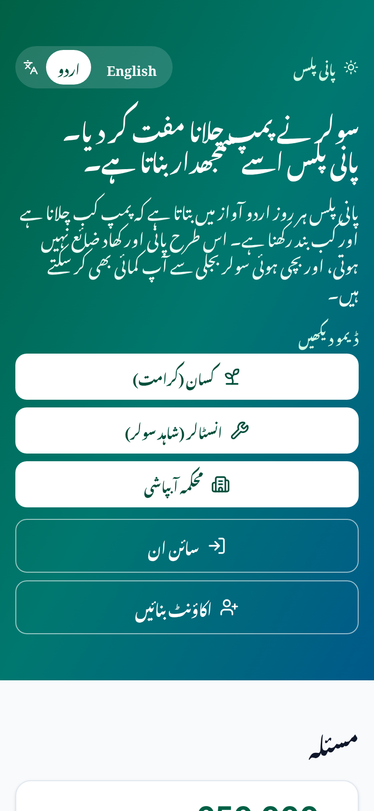<br><sub>Home (Urdu)</sub></td>
    <td align="center">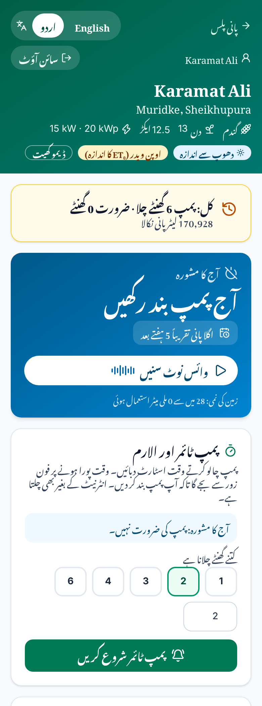<br><sub>Today's advice</sub></td>
    <td align="center">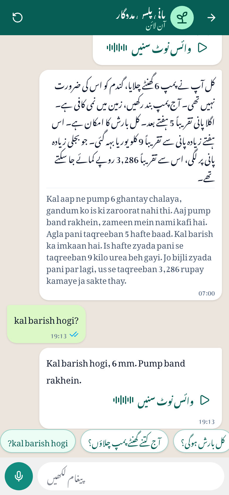<br><sub>Voice + chat assistant</sub></td>
    <td align="center"><br><sub>Pump-off alarm</sub></td>
  </tr>
</table>

**[What is it?](#what-is-it)** · **[Judges guide](#judges-guide)** · **[Demo video](#demo-video)** · **[Pitch slides](#pitch-slides)** · **[Features](#features)** · **[Run it](#run-it-yourself)** · **[Docs](#documentation)**

</div>

---

## What is it?

**The problem.** Pakistan has an estimated **650,000 solar tube wells**. Once the panels are paid for, every extra hour of
pumping costs nothing, so there is no reason for a farmer to stop. Nobody measures how much water is pumped, so neither
the farmer nor the government can see what it does to the aquifer. One peer-reviewed study found solar farms pumped more
than comparable diesel farms in **77% of matched pairs**.

**The idea.** PaaniPulse gives every solar tube well a *virtual* water meter, then uses it to help the farmer:

| | Step | What happens |
|---|---|---|
| 📏 | **Measure** | Litres pumped are calculated from pump size, sunlight and run-hours (or the solar drive's own readings). A 5-minute **bucket test** calibrates it to the pump. |
| 🗣️ | **Advise** | Each morning an **Urdu voice note** and a WhatsApp-style chat say whether to run the pump or keep it off (FAO-56 crop water need and a soil-moisture balance, with live weather). |
| 💰 | **Earn / save** | Hours not pumped become saved fertiliser, saved solar energy and the money that spare energy could earn (e.g. charging batteries). The farmer gets a *private* reason to pump less. |
| 🗺️ | **Map** | Anonymised, district-level groundwater data for the Irrigation Department and lenders, plus a per-well report. |

> **Design rule: code computes, AI speaks.** Every number comes from tested code. The AI only phrases messages, and an
> answer containing any number the engine didn't return is replaced by a rule-based answer.

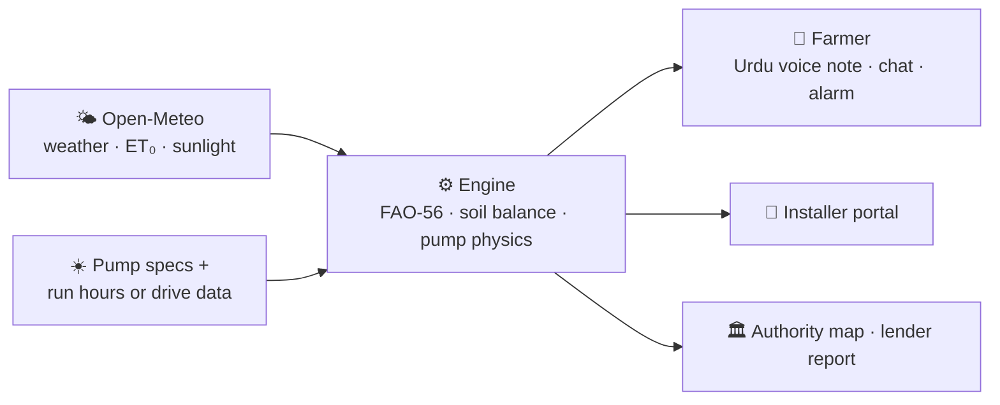

---

## Judges guide

<table>
<tr>
<td width="50%" valign="top">

### ⏱️ The 60-second version
1. Open **[paanipulse.onrender.com](https://paanipulse.onrender.com)** *(free hosting: the first visit can take up to a minute to wake up)*.
2. Tap **Farmer (Karamat)**. No sign-up needed.
3. Read the big card: **"Aaj pump band rakhein"** (keep the pump off today). Tap ▶ to hear it in Urdu.
4. Switch the language with **اردو | English** (top of every page).

</td>
<td width="50%" valign="top">

### 🔑 Demo accounts (one tap on the home page)
| Role | Sign in |
|---|---|
| 🌾 Farmer | `03000000000` / PIN `1234` |
| 🔧 Installer | `installer@paanipulse.demo` / `demo1234` |
| 🏛️ Irrigation Dept | `authority@paanipulse.demo` / `demo1234` |

</td>
</tr>
</table>

### 🧭 A 5-minute evaluation path

| # | Where | What to notice |
|---|---|---|
| 1 | **Farmer dashboard** → top card | *Yesterday: ran 6 h, crop needed 0* → *Today: keep the pump off.* The advice is tied to what this well actually did. |
| 2 | Same page → **This week's waste** and chart | Water lost below the roots, fertiliser washed away, solar energy wasted, and what that energy could have earned. |
| 3 | **Pump output** and **Weather now** cards | Litres per minute, cusec and land watered per hour; live weather with the next 24 hours. |
| 4 | **Bucket test** and **Meter field check** | How the *virtual* meter is calibrated and checked against a real drum measurement. |
| 5 | **Pump timer and alarm** | Start it, set 1 hour: when it ends the phone rings and shows **SWITCH THE PUMP OFF NOW**. Works with no internet. |
| 6 | **Assistant** (chat) | Ask *"kal barish hogi?"* or tap the 🎤 and speak. Numbers match the dashboard exactly. |
| 7 | Sign out → **Installer** | The paying customer: farms they installed, who is over-pumping, register a new farmer. |
| 8 | Sign out → **Irrigation Dept** | Heatmap of 150+ wells, filters, MWh of solar wasted, **Export CSV** (anonymised). Open a well → **report** (printable PDF). |
| 9 | **[/about](https://paanipulse.onrender.com/about)** | Every formula, default, data source and limitation, stated openly. |

### 🔎 What is real and what is simulated

| | Status |
|---|---|
| Engine, formulas, advice, chat guardrail, accounts, access control, offline mode, alarm, reports | ✅ **Real, working, unit-tested** (66 tests) |
| Weather (temperature, rain, ET₀, sunlight) | ✅ Live from Open-Meteo, or from OpenWeatherMap as a backup (then ET₀ and sunlight are **estimated** and labelled). A labelled **sample** is the last resort. |
| The **150 regional wells** on the authority map | 🟡 **Simulated**, shown with a banner. District rankings come from the simulation, not field data. |
| **Karamat's farm** | 🟡 Demo farm modelled on a **real farmer interview**; not a connected farm |
| Pump-drive live meter | 🟡 Uses a **simulator** (`npm run simulate`) for the demo; the data path is real |
| Fertiliser and income figures | 🟡 Labelled **estimates** |
| Field accuracy of the virtual meter, farmer behaviour change | 🔴 **Not yet measured**: no pilot has run. This is our next step. |

### 🎯 How it maps to common judging lenses

<details>
<summary><b>Innovation</b>: measurement without hardware, and a private reason to save</summary>

- A virtual meter from pump physics and sunlight, calibrated by a 5-minute bucket test; the solar drive's data is an optional upgrade.
- Closes the loop other advisory apps leave open: advice is tied to what *this well* pumped yesterday.
- A design that keeps AI honest: deterministic engine + tool-calling assistant + a number guardrail.
- Turns "save water" (a public good) into saved fertiliser and spare-solar income (a private reward).
</details>

<details>
<summary><b>Impact and theme fit</b> (Renewable &amp; Alternative Energy)</summary>

- Solar pumping is renewable energy's biggest rural success story; unmanaged, it drains the aquifer it depends on. PaaniPulse makes the solar boom sustainable.
- Reports **MWh of solar energy wasted** lifting water crops didn't need, and what spare energy could earn.
- Supporting themes: *Energy Storage &amp; Efficiency* (smart metering) and *Energy Finance &amp; Business Model* (installer and lender models, spare-solar income).
</details>

<details>
<summary><b>Feasibility</b>: built, deployed, tested</summary>

- Deployed (Render + Neon), 29 API routes, 15 pages, role-based access, 66 unit tests, about 9,000 lines of TypeScript.
- No hardware needed to start; works in Urdu on a basic phone; degrades gracefully: cached weather, offline advice, SMS option, recorded voice.
- Standard science (FAO-56, pump hydraulics) with every default documented on [/about](https://paanipulse.onrender.com/about).
</details>

<details>
<summary><b>Business model</b>: who pays</summary>

- **Users:** farmers, free. **Payers (hypotheses):** solar installers (after-sales service, about Rs 1,000–2,000 per pump per year), then lenders, then the Punjab Irrigation Department (water accounting for subsidised wells).
- The installer portal and the lender report are built to show those two paths. No installer has committed yet; see the honest list above.
</details>

<details>
<summary><b>Design for farmers</b>: low literacy, poor internet</summary>

- Urdu first (right-to-left, Nastaliq), voice notes and voice input, large buttons, minimal text.
- **No internet:** the last advice is saved on the phone and shown offline; reports queue and send later.
- **No smartphone or data:** opt-in daily advice by SMS/WhatsApp. **Pump-off alarm:** a loud timer on the phone.
</details>

### 🙋 Questions we expect

<details>
<summary><b>"How is this different from asking ChatGPT?"</b></summary>
The numbers come from tested FAO-56 and pump-physics code that knows this farm's location, crop, pump and last week's run-hours. The AI only phrases them, and the server blocks any answer containing a number the engine didn't produce.
</details>

<details>
<summary><b>"Is the virtual meter accurate?"</b></summary>
It is an estimate and shown as a range with a "default / calibrated" badge. The physics is standard and tested, and a bucket test calibrates it per pump. <b>We have not yet compared it with a real flow meter in the field.</b> The in-app field check exists for exactly that, and it is the first thing we will do in a pilot.
</details>

<details>
<summary><b>"How do you reach your first 100 users?"</b></summary>
Through installers, who meet every farmer at the point of sale and can register them in the portal, and through aarhtis and input dealers who stay in touch with farmers all season.
</details>

<details>
<summary><b>"What if the farmer ignores the advice, or the pump can't be controlled?"</b></summary>
The farmer switches the pump at the breaker; the app can warn (timer alarm, over-run SMS) but cannot switch the motor off. A smart relay or timer fitted by the installer is the next product step, with the farmer's permission.
</details>

<details>
<summary><b>"Will farmers fear a water tax?"</b></summary>
Data is farmer-owned. Authorities and lenders only see anonymised, district-level data from farms that consented, with locations blurred to about 1 km. Farmer-facing language is about saving fertiliser and earning, not compliance.
</details>

<details>
<summary><b>"What did you actually validate with farmers?"</b></summary>
One real farmer interview (pump size, run-hours, "about double the water since solar", bore deepening, fertiliser loss, installer and aarhti roles, willingness to pay after seeing results). No pilot yet. Details and gaps: <a href="PRODUCT_ESSENTIALS.md#6-validation-status-be-honest-about-this">PRODUCT_ESSENTIALS.md</a>.
</details>

---

## Demo video

[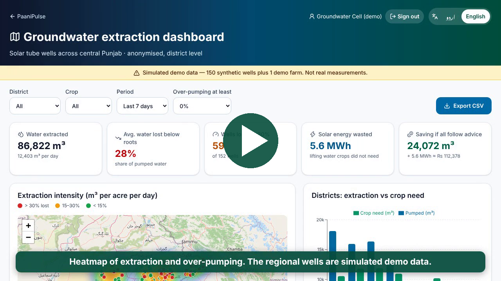](docs/demo/paanipulse-demo.mp4)

▶ **[Watch the demo (2 min 30 s, MP4, with voice-over)](docs/demo/paanipulse-demo.mp4)**: recorded on the live site, with captions.
Karamat's Urdu advice → this week's waste → pump output → live weather → pump-off alarm → **the farmer asks by voice and
the assistant answers aloud** → one sign-in page for farmers, installers and the Irrigation Department → heatmap →
lender report. *The regional wells in the video are simulated demo data. The narration and the spoken answer were added in
editing with a free offline voice; in the app itself, spoken answers need the optional Azure Urdu voice or a recorded file.*

## Pitch slides

📊 **[Download the 3-minute pitch deck (PPTX)](docs/slides/PaaniPulse-pitch-3min.pptx)** · [PDF version](docs/slides/PaaniPulse-pitch-3min.pdf)

- **3-minute final pitch**: 7 slides, hook → problem → solution → live demo → why trust the numbers → who pays → next steps and ask.
- **Simple 7-slide version** ([PPTX](docs/slides/PaaniPulse-pitch-simple.pptx) · [PDF](docs/slides/PaaniPulse-pitch-simple.pdf)): cover, problem, the idea, has it been done before, what we have built, features, close. Plain wording, app screenshots, no QR codes, no business slides.
- 📊 **[5-minute mentor version (PPTX)](docs/slides/PaaniPulse-pitch-5min-mentor.pptx)** · [PDF](docs/slides/PaaniPulse-pitch-5min-mentor.pdf): 10 slides, adding why existing tools fall short, honest status, and impact and theme fit. Six hidden appendix slides (architecture, maths, competitors, privacy and offline, roadmap, farmer interview) are there for Q&A.

Speaker notes with timings are in both PPTX files. The outline is in [docs/PITCH_DECK.md](docs/PITCH_DECK.md).

---

## Features

<details open>
<summary><b>🌾 For the farmer</b></summary>

- **Daily advice** in an Urdu voice note, text and chat: run N hours / keep the pump off / skip for rain, with the reason and the next irrigation date. Wheat first-watering rule (crown-root stage).
- **Yesterday vs need**, **this week's waste** (water below the roots, urea washed away, solar energy wasted) and a 7-day chart.
- **Spare sunshine**: kWh and rupees that spare energy could earn (battery charging, grain drying, cold storage).
- **Pump output**: litres per minute, cusec, land watered per hour (kanal / acre).
- **Weather now** plus the next 24 hours; refreshes itself while the app is open.
- **Assistant**: WhatsApp-style chat in Urdu script, Roman Urdu or English; speak or type; reads answers aloud.
- **Pump timer and alarm**; **live meter** with an over-run warning (when a drive is connected).
- **Offline mode**; opt-in **daily advice by SMS / WhatsApp**; installable on the home screen.
- **Bucket test** and **meter field check**; **4-step farm set-up** with a map and typical-pump defaults.
- **Water chart** (`/water-chart`, public, no sensors, no internet): crop + stage + soil + season + land → how often and how much water. Plus a soil-type choice in farm set-up. See [docs/WATER_CHART.md](docs/WATER_CHART.md).
- **Open-loop water plan**: depth, volume for the field's area and pump hours; a conservative "rain is a bet" rule; a "how sure is this advice" line. See [docs/OPEN_LOOP_AND_RISK.md](docs/OPEN_LOOP_AND_RISK.md).
- **Land in your own unit** (acre, kanal, marla, murabba, ghumaon) and **Fertiliser for your land**: you enter the rate from your soil test or officer, the app totals it for your land and times the doses with your irrigation. See [docs/LAND_UNITS_AND_FERTILISER.md](docs/LAND_UNITS_AND_FERTILISER.md).
- **Soil probe card** (optional, software only, tested with a simulator; no probe hardware connected): see [docs/SOIL_SENSOR.md](docs/SOIL_SENSOR.md).
</details>

<details>
<summary><b>🔧 For installers</b></summary>

- Register a farmer and farm at the point of sale; see every installed farm with its water-loss status, calibration and drive status.
- Reset a farmer's PIN in person; open any farm's dashboard or printable report.
</details>

<details>
<summary><b>🏛️ For the Irrigation Department and lenders</b></summary>

- Heatmap of extraction (m³ per acre per day) with clickable wells; filters by district, crop, period and over-pumping.
- KPIs: water extracted, share lost below the roots, wells losing over 30%, **MWh of solar wasted**, saving if all follow the advice.
- District chart and table; anonymised **CSV export**; per-well **printable report** with a stewardship score.
</details>

<details>
<summary><b>🛡️ Trust, privacy and reliability</b></summary>

- Farm data is readable only by its owner or installer; authorities see anonymised, consented, district-level data.
- PINs and passwords are hashed; login rate-limited; demo accounts can't be changed.
- Fallbacks at every dependency: weather (live → saved → sample), AI (model → smaller model → rule-based), voice (neural → recorded → phone).
</details>

---

## Gallery

<details>
<summary>Show more screenshots</summary>

| | |
|---|---|
| **Farmer dashboard (English)**<br>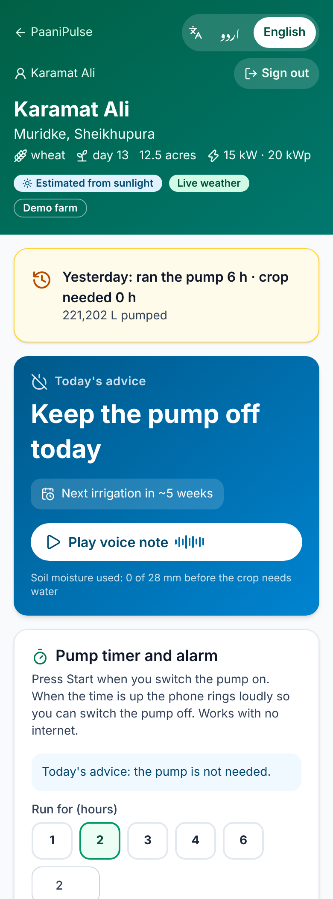 | **Authority dashboard**<br>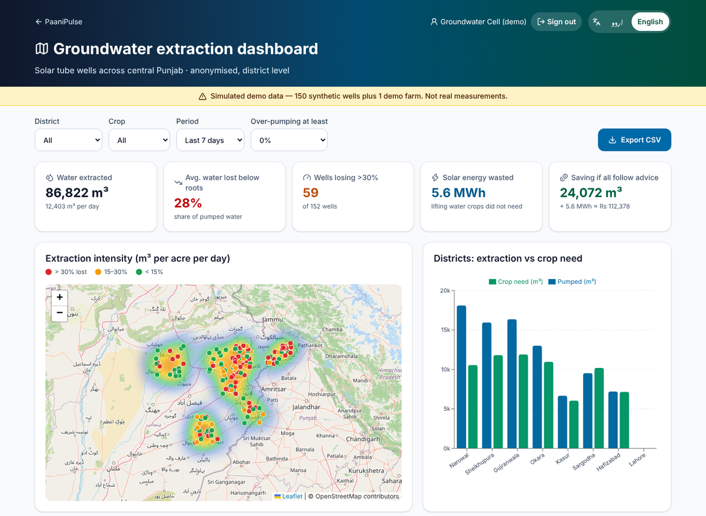<br><sub>Map tiles load from OpenStreetMap online; the heatmap and wells always show.</sub> |
| **Installer portal**<br>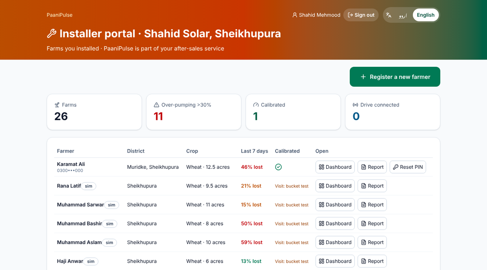 | **Well report for lenders**<br>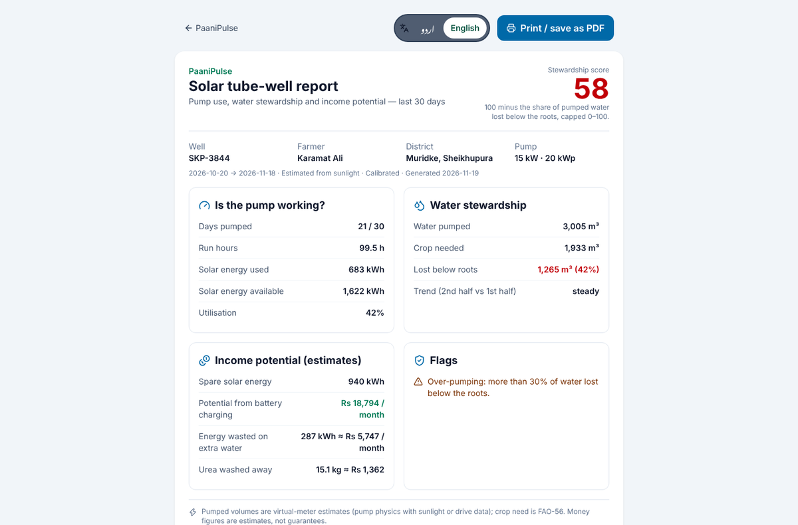 |
| **Weather now and next 24 hours**<br>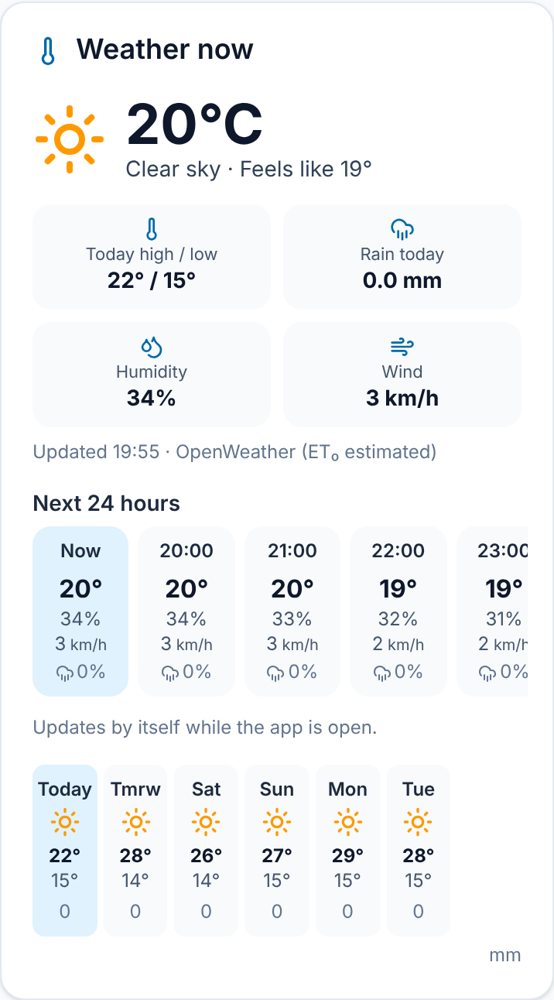 | **Pump output**<br>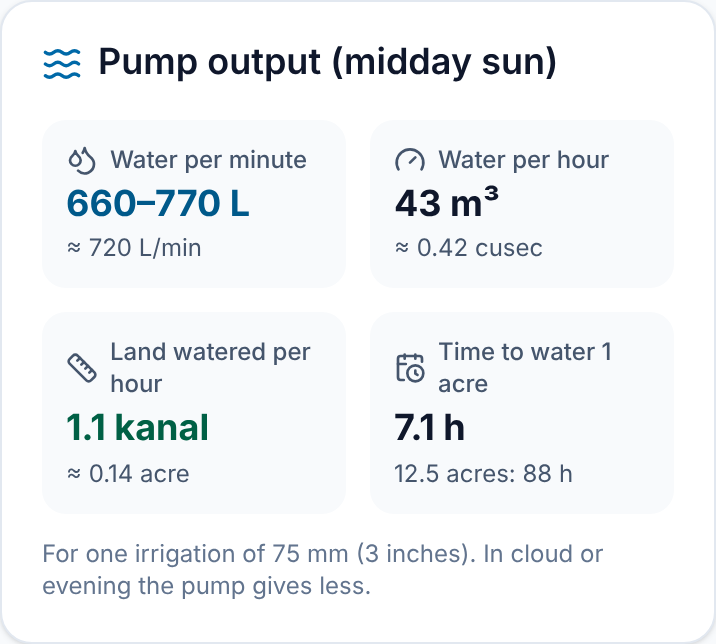 |

*Screenshots were taken on the live site. The regional wells are simulated demo data; weather is real.*
</details>

---

## How the numbers work

<details>
<summary>Formulas (full list and defaults on <a href="https://paanipulse.onrender.com/about">/about</a>)</summary>

```
Crop water      ETc = Kc × ET₀                (FAO-56 coefficient by growth stage)
Soil balance    Dr(t) = Dr(t-1) + ETc − 0.8·rain − pumped·efficiency/area
                irrigate when Dr ≥ RAW = p × 140 mm/m × root depth, otherwise "keep the pump off"
Pump head       H = (water level + 3 m) × 1.1
Flow            Q = η × P / (ρ g H)           (η = 0.40 default; bucket test sets the real value)
Solar power     P = kWp × sunlight/1000 × 0.75, capped at pump kW
Waste           kWh = excess m³ × ρ g H / η / 3.6e6        value = kWh × Rs 20
```
</details>

<details>
<summary>How the AI stays honest</summary>

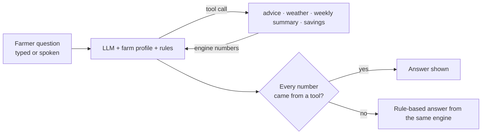
The model is not fine-tuned: personalisation comes from the farm profile in its instructions, the tools' farm-specific results and the last few messages.
</details>

---

## Run it yourself

<details>
<summary>Quick start (Node 20.19+ and PostgreSQL; a free Neon branch works)</summary>

```bash
cp .env.example .env        # set DATABASE_URL, DIRECT_URL and AUTH_SECRET at least
npm install
npx prisma migrate dev      # creates the tables and seeds Karamat + 150 simulated wells
npm run dev                 # http://localhost:3000
```

| Command | What it does |
|---|---|
| `npm test` | 66 unit tests (engine, services, auth, chat guardrails) |
| `npm run lint` / `npm run build` | Lint / production build with a full type-check |
| `npm run seed` | Reset the demo data |
| `npm run simulate` | Stream live pump-drive readings for the demo farm (`-- --url https://your-app`) |

**Only `DATABASE_URL`, `DIRECT_URL` and `AUTH_SECRET` are required.** Everything else is optional and the app degrades gracefully:
no Groq key → rule-based chat; no Azure key → recorded or phone voice; no text-message or email service → forgotten PINs are
reset by the installer. Weather needs **no API key** (Open-Meteo free tier). Full variable table:
[docs/DEPLOYMENT.md](docs/DEPLOYMENT.md#1-environment-variables).
</details>

<details>
<summary>Deploy (Render + Neon, free)</summary>

Step-by-step, scheduled jobs, the health check at `/api/health?full=1` and a troubleshooting table are in
[docs/DEPLOYMENT.md](docs/DEPLOYMENT.md).
</details>

<details>
<summary>Account recovery (no extra services needed)</summary>

A farmer who forgets their PIN asks the **installer** who set up the pump; the installer sets a new PIN from the portal (identity
checked in person). Installers and officials can use the emailed-link reset if an email service is configured. Optional text-message
codes for farmers are supported but not required.
</details>

---

## Tech stack

Next.js 15 (App Router) · React 19 · TypeScript · Tailwind CSS v4 · PostgreSQL (Neon) + Prisma · Zod · Recharts · Leaflet ·
Open-Meteo · Groq (LLM and Whisper speech-to-text) · Azure Speech (Urdu voice) · Vitest · Render · GitHub Actions.

```
app/ pages + API routes     lib/engine/ pure, unit-tested maths     lib/services/ weather, chat, reports
components/ UI              prisma/ schema, migrations, seed        scripts/ telemetry simulator
docs/ guides + screenshots  tests/ Vitest suites                    .github/ scheduled jobs
```

## Documentation

| | |
|---|---|
| 💼 [BUSINESS_PLAN.md](BUSINESS_PLAN.md) | Business plan: pricing from farmer value, revenue "wheels", cost model, unit economics and ROI, phases, KPIs, assumptions, risks |
| 📘 [PRODUCT_ESSENTIALS.md](PRODUCT_ESSENTIALS.md) | Problem, users, who pays, built vs simulated, validation status, roadmap, risks, sources |
| 🏗️ [ARCHITECTURE.md](ARCHITECTURE.md) | System diagram, data model, engine, request flows, security, API list, limitations |
| 🚀 [docs/DEPLOYMENT.md](docs/DEPLOYMENT.md) | Environment variables, Render + Neon, scheduled jobs, troubleshooting |
| 📊 [docs/PITCH_DECK.md](docs/PITCH_DECK.md) · 🎬 [docs/VIDEO_SCRIPT.md](docs/VIDEO_SCRIPT.md) | Slide-by-slide outline for the 3- and 5-minute pitch; video storyboard and narration |
| 🎤 [docs/DEMO_SCRIPT.md](docs/DEMO_SCRIPT.md) · 🧑‍🏫 [docs/MENTOR_PREP.md](docs/MENTOR_PREP.md) | The 3-minute demo; pitches, questions and a readiness checklist for mentor sessions |
| 🧪 [docs/BUCKET_TEST.md](docs/BUCKET_TEST.md) | How to calibrate and field-check the meter with a drum and a phone (English and Urdu) |
| 🖨️ [docs/qr/](docs/qr) | Printable A5 card with the QR code to the live site |
| 🤝 [CONTRIBUTING.md](CONTRIBUTING.md) · 🔒 [SECURITY.md](SECURITY.md) · 📝 [CHANGELOG.md](CHANGELOG.md) | Working on it, reporting problems, history |

## Team

**Qursam Bibi** and **Muzammil Hussain**: built for the LUMS Centre for Entrepreneurship × OGDCL CleanTech Hackathon 2026.

## Licence

[MIT](LICENSE) © 2026 Qursam Bibi and Muzammil Hussain
